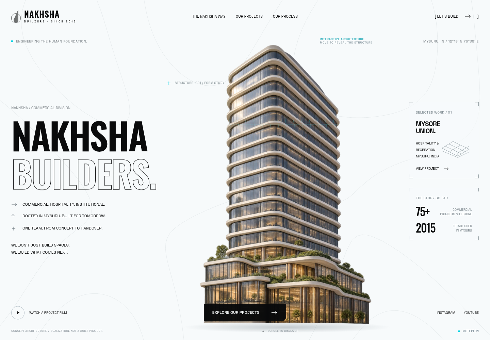

# Nakhsha Builders — built for what’s next

A commercial-architecture adaptation of the supplied **KIMI / GRIDO1 Racing Systems** reference: near-white, black, cyan, Oswald and Space Grotesk, an interactive architectural subject, and five distinct scroll chapters.



## Open the website

`index.html` is a single self-contained HTML file. Images, fonts, Three.js 0.185.0, and Lenis 1.3.26 are embedded. There are **no runtime downloads, package installation, framework, or build step** needed to view it. `standalone.html` is an identical copy retained for convenience.

To serve the page locally:

```sh
python -m http.server 3000 --bind 0.0.0.0
```

The page can be hosted on any static HTML host. This repository does not imply that a public website has been deployed.

## How the reference is used

| Supplied reference | Nakhsha implementation |
| --- | --- |
| Light hero, condensed title, identity rail and bracketed panels | Architectural stage, Nakhsha identity, commercial metadata, featured project and published milestones |
| Helmet burn, cursor trail and wireframe scan | Commercial tower texture with a cyan crown-to-base structural reveal, shallow parallax, cursor-trail blueprint reveal and periodic structural scan |
| One spring/ticker engine and smooth scrolling | Mass-one spring solver with 1ms substeps and capped frame time; all scenes and Lenis driven by one ticker |
| First two pinned sheets recede under the next layer | Hero and delivery sheets scale to 0.9 and darken to 55%; too-tall screens use normal flow so controls remain reachable |
| Chequer dissolve into dark instrument map | Deterministic chequer seam, halftone architectural floor plan, six-second cyan trace, four milestones, hub pings and cursor reticle |
| Stepped-corner photographic timeline | Six published Nakhsha projects, alternate photo plates, center progress thread, rotating marker, parallax and pointer dimming |
| Light paddock / calendar | Light process chapter, architectural subject, four connected delivery stages |
| Cyan-edged dark sign-off | 16px cyan edge, inset black panel, contour field, architectural figure and letter-revealed navigation |

The fonts, palette, section hierarchy, framing, geometry, and motion system follow the supplied reference. The racing driver, helmet, race calendar, and racing copy are replaced with commercial architecture and Nakhsha information. The tower is an architectural image with WebGL shader effects, not a navigable volumetric building model.

## Screenshots

- [Desktop opening](docs/desktop-preview.png)
- [Phone opening](docs/mobile-preview.png)
- [Architectural instrument stage](docs/blueprint-preview.png)
- [Project timeline](docs/projects-preview.png)
- [Closing chapter](docs/footer-preview.png)

## Edit and regenerate

Editable authoring files are in `src/`; project content and provenance are in `project-data.json`. The contour and drafting helpers are in `scripts/` and library sources/licenses in `vendor/`.

After editing, regenerate both self-contained HTML files:

```sh
python scripts/export.py
```

Only Python’s standard library is required. Three.js and Lenis are embedded through the import map. The vendored libraries were extracted from the official npm tarballs after checking their registry SHA512 integrity. TLS and package verification were retained.

## Published content and photography

Verified against:

- https://nakhsha.in/nakhsha-builders
- https://nakhshabuilders.com/
- The original project detail URLs recorded in `project-data.json`.

The collection includes **Mysore Union, Cosmopolitan Club, Continental Inn, Iconic Resto Pub, MICA, and Rahul Cafe**. Source photography is hosted within the HTML. Four projects have verified official YouTube films linked from their dialogs; projects without a verified direct film have no film button.

Published company facts include establishment in 2015, the 75+ commercial-project milestone, and 150+ professionals across teams. Contact details come from Nakhsha’s commercial page. Areas, scope, status, sources, and video provenance are recorded in `project-data.json`. No prices, sale availability, or invented completion dates are claimed.

The central tower is a generated **concept visualization**, labeled on the site, and is not represented as a built Nakhsha project. The company symbol is sourced from Nakhsha’s official site and recolored through a mask to fit the reference palette. Font licenses are in `assets/`; library licenses are in `vendor/`.

## Validation and accessibility

Chromium validation covered:

- Actual Three.js shader compilation/rendering, loader handover, and cursor reveal.
- A run with all external network requests blocked: the full interactive site still renders.
- Desktop sheet recession, the six-second drafting trace, and project timeline.
- Layouts at 375×667, 390×844, 768×1024, 1280×720, 1440×1000, and 1920×1080, with no horizontal overflow.
- Short-screen main-action reachability, mobile menu, keyboard Escape, project dialogs, and verified video/source links.
- Reduced-motion presentation and a WebGL-disabled architectural still fallback.
- No page errors or console errors in the normal interactive run.

Text reveals retain a plain screen-reader copy; animated units and canvases are hidden from assistive technology. Native dialogs provide focus containment, Escape closing, and focus return. Motion can be disabled with the page control and follows the system preference. Visible failure notices preserve a useful still-image page when an interactive capability is unavailable.
