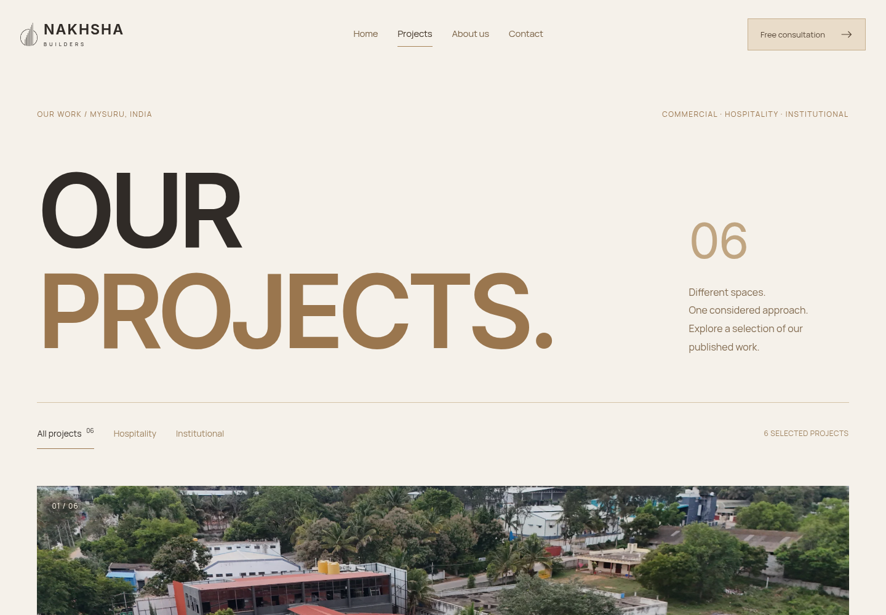

# Nakhsha Builders — commercial architecture, in motion

A cream-and-beige website with a scroll-directed 3D opening, large photographic project showcases, and separate pages for Projects, About and Contact.


## Pages

| Page | Route | Experience |
| --- | --- | --- |
| Home | `/` | Real 3D architectural study with four scroll chapters, warm contour fields, traced floor plan and animated portfolio |
| Projects | `/projects/` | Oversized typography, full-width and paired photographic cards, hospitality/institutional filters |
| Case studies | `/projects/<project-slug>/` | Full-width cover, published project details, five-photo keyboard/touch gallery, film links where verified, next-project navigation |
| About | `/about/` | Nakhsha team photograph, company milestones and delivery approach |
| Contact | `/contact/` | Dedicated consultation form with project-context handoff and the retained verification backend |

The six case studies cover Mysore Union, Cosmopolitan Club, Continental Inn, Iconic Resto Pub, MICA and Rahul Cafe. Header, mobile menu and footer links navigate between actual pages. Relative links support deployment at a domain root or beneath a GitHub Pages repository prefix. Deep URLs are ordinary directory indexes and need no SPA rewrite.



## Motion and identity

The intro follows the dedicated Nakhsha Builders reference: a clipped, spring-driven logo reveal, drafting lines, then three vertical shutters. It uses the exact unmodified Builders logo from `https://framerusercontent.com/images/fPEtmK8kth6g5lYp7BXkMvceeoU.png`, published on https://nakhshabuilders.com/. The first visit gives the branding room to appear; subsequent pages use a shorter transition. Reduced-motion preferences skip the intro.

The home model is actual Three.js geometry: 23 tower levels, curved floor fins, glazing, mullions, a stepped podium, roof volumes, planting, lighting and shadows. Its camera, orientation and floor separation respond to the scroll chapters. Viewpoint buttons offer direct controls, including on short screens and reduced-motion devices. This is a labelled illustrative architectural study, not a built Nakhsha development.

Actual browser recording, sped up for the preview.


Large Inter headings and Manrope body text on the new pages take cues from the Builders reference. Scroll reveals, photographic parallax, gallery transitions and native page transitions extend the motion across the site. The earlier cinematic home composition, warm animated contours, live photographic plates and blueprint chapter remain. Offscreen or covered WebGL rendering pauses.

Thirty distinct published project photographs are available. The process chapter uses a Continental Inn lobby; the closing chapter uses the Iconic Resto Pub exterior. The About page uses Nakhsha’s published team photograph. Interface surfaces stay cream, beige, warm stone and bronze.

## Run

Python 3.10+, no package dependencies:

```sh
python server.py --port 3000
```

This serves all prebuilt pages and the consultation API from one origin. Every HTML page embeds its required local imagery, branding and fonts. The home also embeds Three.js 0.185.0 and Lenis 1.3.26; inner pages omit those libraries. No runtime CDN, remote 3D model, package installation or frontend build is required to view the prebuilt site.

`standalone.html` is an identical copy of the home page. Keep the generated page directories alongside it for navigation to Projects, About, Contact and the case studies.

Static-only hosting cannot run the consultation API. The form then offers a clearly labelled **Prepare email enquiry** action, without claiming a message was sent. Deploy the included backend for direct verified submissions. Pushing the code does not deploy it to a public domain.

## Consultation flow

The dedicated Contact page retains the original form fields and verification controller. Case-study enquiry links use a whitelisted project slug to prefill the message and display its context; an existing message is preserved.

The backend maintains a separate official PHP session for each browser. It fetches current public verification tokens server-side, relays user-requested WhatsApp OTP actions, and submits to the official handler after mobile verification and human confirmation. Tokens and cookies stay in server memory. Success requires the recognised official delivery receipt; uncertain results are not shown as success or blindly retried.

There are no automatic OTP sends or automatic enquiries. Same-origin checks, bounded payloads, session expiry, verification limits and duplicate protection remain. The public, undocumented official PHP interface may change; visible fallback contact options remain available. For HTTPS hosting, use a reverse proxy with `X-Forwarded-Proto: https` or set `NAKHSHA_SECURE_COOKIE=1` so the session cookie is Secure.

Development form tests use mocked API responses. **No real OTP or enquiry was sent.** Live message delivery is not claimed as tested.

## Authoring

- `src/index.template.html`, `src/site.css`, `src/site.js`: the cinematic home.
- `src/shared-*.html`, `src/shared.css`, `src/shared.js`: shared brand intro, navigation and page shell.
- `src/projects.template.html`, `src/project-detail.template.html`, `src/pages.css`, `src/pages.js`: collection, case studies, filters, photo parallax and galleries.
- `src/about.template.html`, `src/about.css`: company page.
- `src/contact-page.template.html`, `src/contact-page.css`, `src/contact.css`, `scripts/contact-form.js`: dedicated contact layout and retained verification UI.
- `scripts/architectural-model.js`, `scripts/contour-field.js`, `scripts/drafting-canvas.js`: model and canvas helpers.
- `server.py`: consultation bridge and static server.
- `project-data.json`, `project-media.json`: published content and photograph provenance.
- `scripts/export.py`: deterministic standard-library generator for all ten pages and the standalone home copy.

After editing sources:

```sh
python scripts/export.py
```

Run backend checks without sending production enquiries:

```sh
python -m unittest discover -s tests -v
```

## Sources and licenses

Project content and photography come from https://nakhsha.in/nakhsha-builders and the https://nakhshabuilders.com/ project pages recorded in the JSON files. Four projects have verified official films; the other two do not display a film link. Unpublished floor areas are labelled “Not published.” Company contact information follows the verified Nakhsha.in details already used by this site.

The Builders preloader artwork is saved as `assets/builders-preloader-logo.png`. The team photograph comes from `https://nakhsha.in/assets/images/media/leadership/Group.webp`. Font licenses are retained in `assets/`; pinned library MIT notices are in `vendor/`. The libraries were extracted from SHA512-verified npm packages.

## Validation

The build completes for all ten pages with no unresolved placeholders or broken internal links. Ten mocked backend tests pass. Browser checks cover the original-logo intro, real WebGL rendering and four viewpoints, Home → Projects → case study → contextual Contact navigation, filters, gallery arrows/thumbnails/Escape, mobile menus, direct deep links, Back navigation, reduced motion and WebGL fallback.

Responsive checks cover phone, tablet and desktop. Browser form checks exercise field validation, consent, mocked OTP verification, human confirmation, receipt-only success, uncertain delivery and static email-draft fallback. No production verification messages or enquiries are sent by these checks.

[Preloader](docs/preloader-preview.png) · [Home](docs/desktop-preview.png) · [Phone](docs/mobile-preview.png) · [Projects](docs/projects-preview.png) · [Project detail](docs/project-detail-preview.png) · [Contact](docs/contact-preview.png) · [Consultation form](docs/contact-form-preview.png) · [About](docs/about-preview.png)
